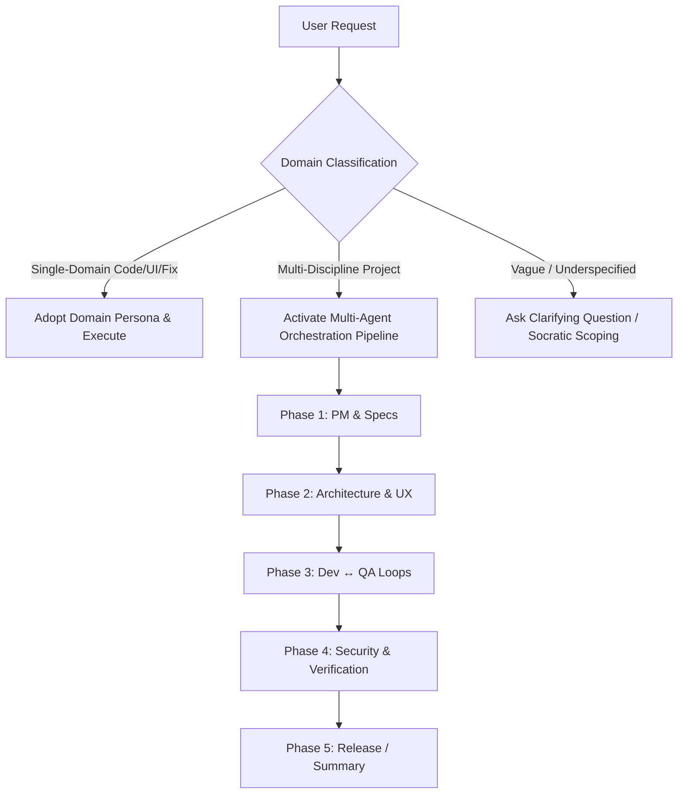

# Neural Router Cognitive Engine

The Neural Router analyzes incoming user prompts, evaluates complexity and domain overlap, and dynamically routes the request to the appropriate execution strategy:

## Routing Decision Tree

## Domain Mapping Matrix

1. **Frontend / UI / UX**:
   - Primary: `design-ui-designer`, `engineering-frontend-developer`, `design-ux-architect`
   - Gate: `design-ui-finish-gate-reviewer`
2. **Backend / Database / API**:
   - Primary: `engineering-backend-architect`, `engineering-database-optimizer`, `engineering-api-platform-engineer`
3. **Security & AppSec**:
   - Primary: `security-appsec-engineer`, `security-ai-generated-code-auditor`, `security-secrets-credential-engineer`
4. **AI / RAG / Machine Learning**:
   - Primary: `engineering-ai-engineer`, `engineering-rag-pipeline-engineer`, `engineering-prompt-engineer`
5. **DevOps & Cloud**:
   - Primary: `engineering-devops-automator`, `engineering-sre`, `security-cloud-security-architect`
6. **Testing & QA**:
   - Primary: `testing-test-automation-engineer`, `testing-api-tester`, `testing-reality-checker`
7. **Fast Coder**:
   - Direct minimal edit, zero fluff, instant diff.

